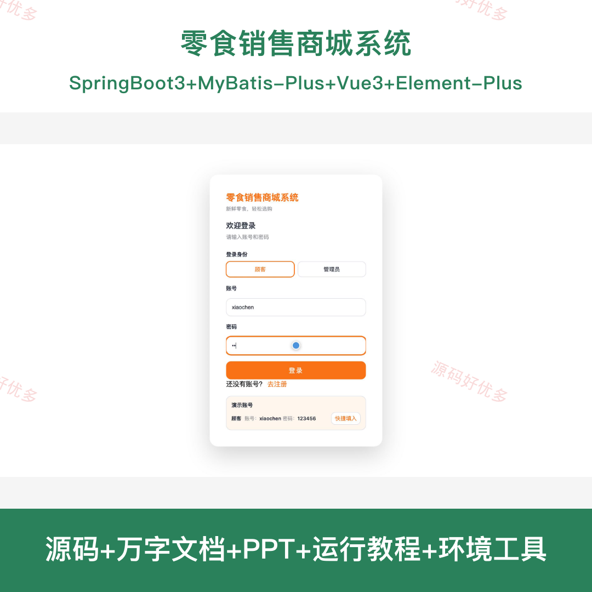
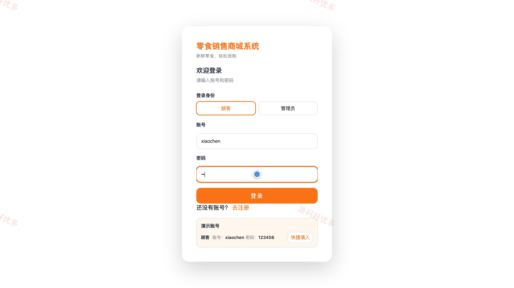
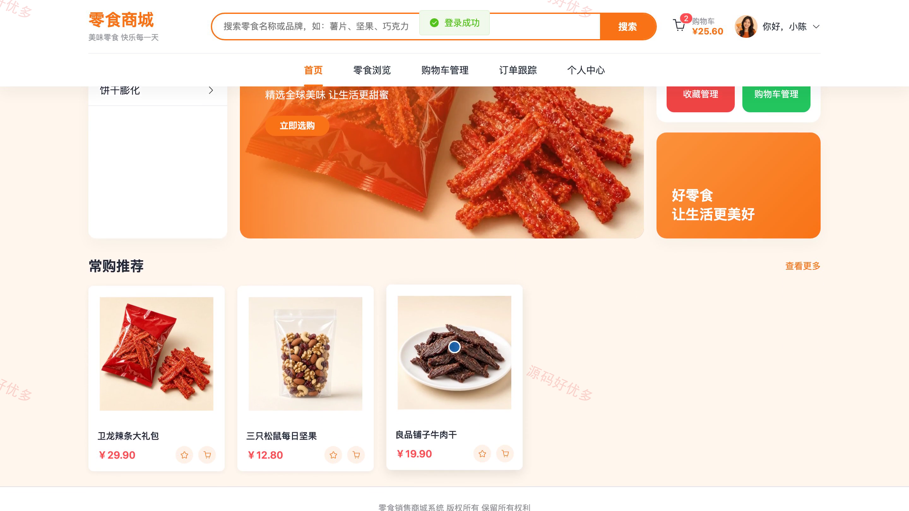
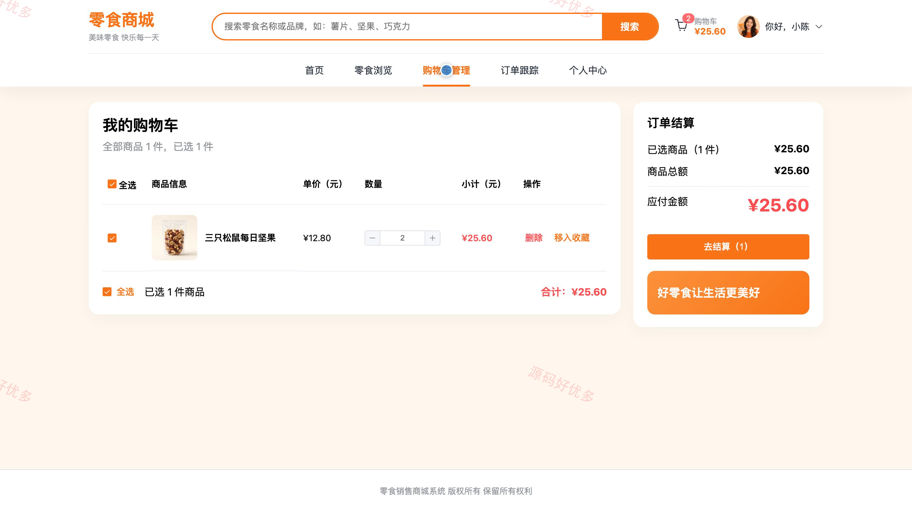
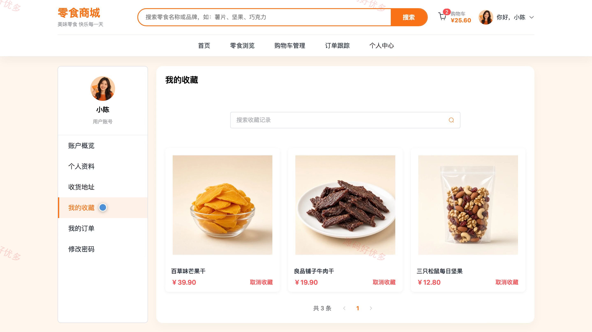
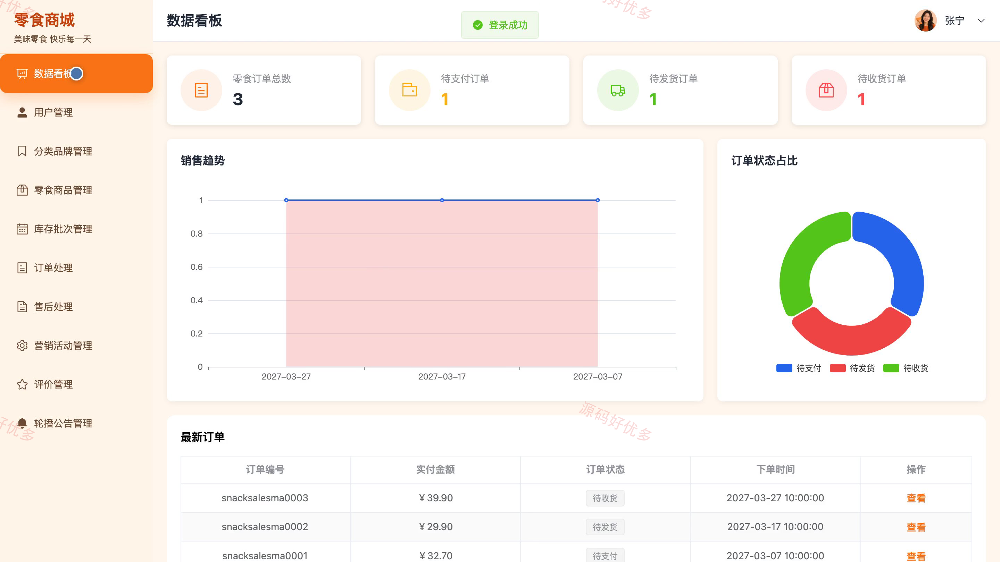
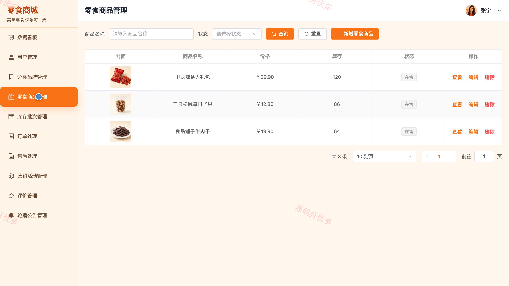
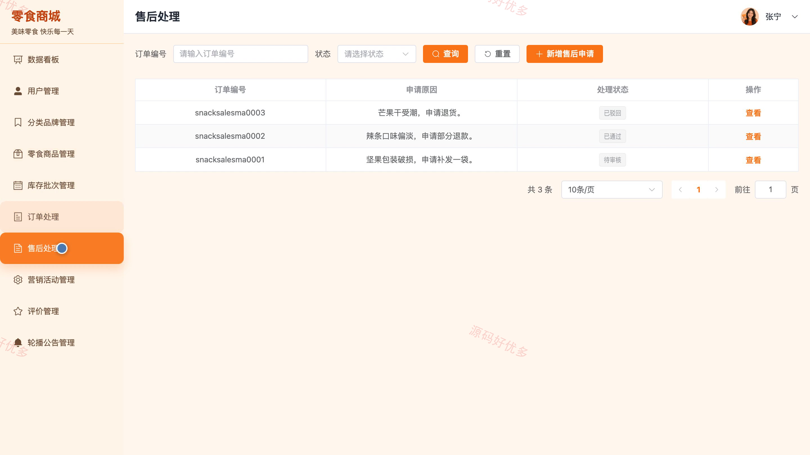
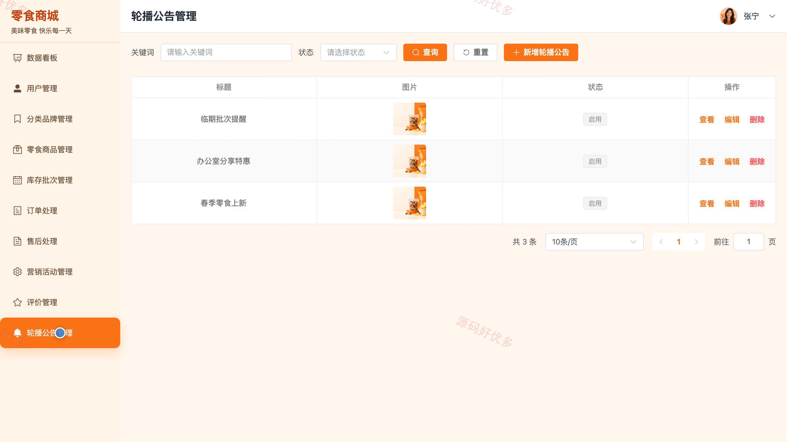

# bs123A
bs123A零食销售商城系统
## 源码问题查看主页咨询

### 一、关键词
零食商城、休闲食品网店、零食网购、食品电商、在线零食销售

### 二、作品包含
源码+数据库+万字设计文档+PPT+全套环境和工具资源+本地部署教程

### 三、项目技术
前端技术： Html、Css、Js、Vue3.4、Element-Plus
后端技术：Java、SpringBoot3.2.0、MyBatis-Plus

### 四、运行环境要求
开发工具：IDEA/eclipse + VSCODE

数据库：MySQL5.7+（共17张表）

数据库管理工具：Navicat10以上版本

环境配置软件： JDK17 + Maven3.6

前端Nodejs：16+

浏览器：谷歌浏览器

### 五、项目介绍
项目编号：bs123A

零食销售商城系统面向顾客和管理员，提供零食商品展示、收藏、购物车、订单及收货地址管理，并支持后台维护商品、库存、营销活动和售后业务。

角色：用户、管理员

用户功能：零食商品浏览与查询、商品浏览与互动、购物车管理、收货地址管理、订单提交与查询、个人资料与密码管理。

管理员功能：经营数据看板、用户账号管理、零食分类与品牌管理、商品与库存批次管理、订单与售后处理、营销活动管理、商品评价管理、轮播与公告管理。

### 六、运行截图

